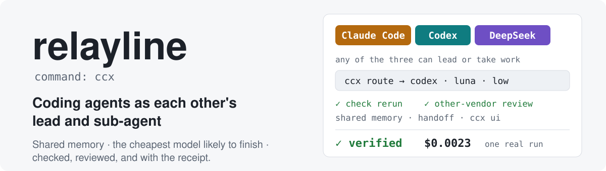
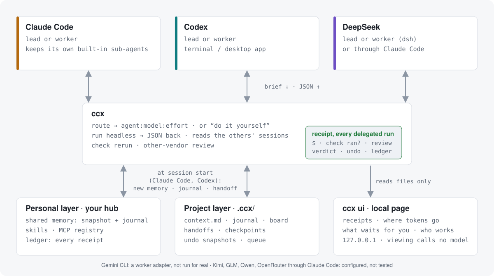
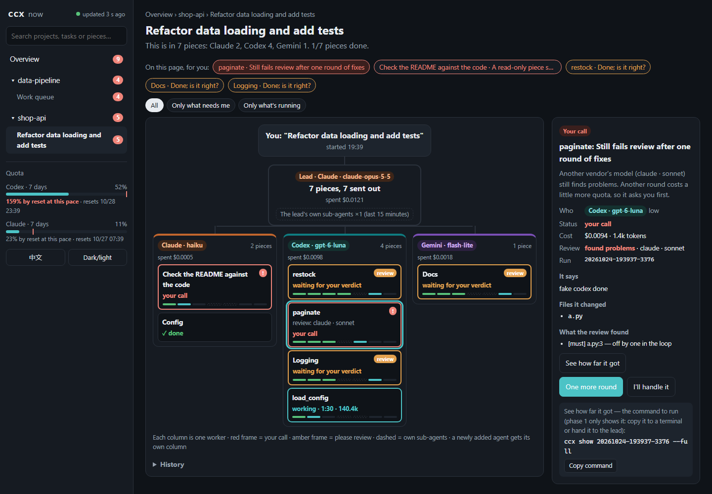
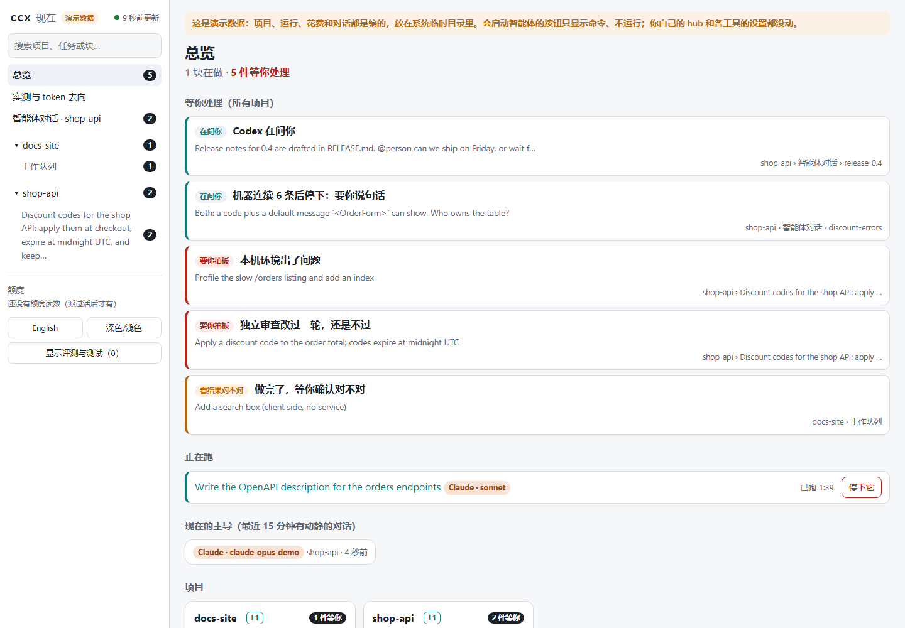
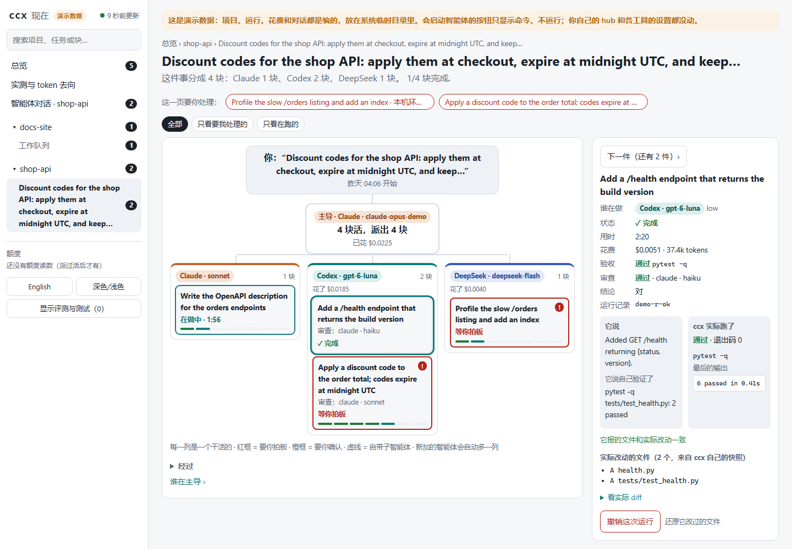

<picture>
  <source media="(prefers-color-scheme: dark)" srcset="docs/assets/banner-dark.svg">
  
</picture>

<p align="center">
  <a href="https://github.com/SUPERD6/relayline/actions/workflows/test.yml"></a>
  
  
  <a href="LICENSE"></a>
  <a href="https://github.com/SUPERD6/relayline/releases"></a>
</p>

<p align="center">English · <a href="README.zh.md">中文</a> · <a href="https://superd6.github.io/relayline/">Website</a></p>

# relayline

**Coding agents as each other's lead and sub-agent: shared memory, work split by difficulty, every piece checked,
and a receipt for what it cost.** Claude Code or Codex can lead; Gemini CLI and DeepSeek (through Claude Code, through
Codex, or DeepSeek's own DeepSeek Harness) can take work too, and so can a few smaller APIs (Kimi, GLM, Qwen,
OpenRouter) through Claude Code. The command is `ccx`; Python standard library only.

```bash
pipx install git+https://github.com/SUPERD6/relayline
ccx setup                    # guided: explains each step and asks before changing anything
ccx run --to codex --mode read "Summarise README.md in three lines"
```

<p align="center"></p>

> **Work in progress (v0.4, October 2026).** It runs every day on one Windows machine, both directions, terminal and
> desktop apps.
> - **Does it save money? The first measurements say "it depends"** (next section): small tasks save only when the
>   lead trusts ccx's check result. The week-long comparison (`ccx trial`) is still collecting; routing priors are
>   uncalibrated.
> - **Tested only with stand-in CLIs:** the work queue (`ccx q`), seats, worktrees and `ccx batch`, fallback to the
>   other agent on a real quota stop. Gemini CLI has never run for real. macOS and Linux
>   run in CI only.
> - **Not built yet:** `ccx stop`, fuller shared memory
>   (see "Next" in [STATUS](docs/STATUS.md)). The website is not published yet.
>
> Early commit ids in older notes (CHANGELOG, docs/STATUS) refer to the private history squashed before going
> public. See [STATUS](docs/STATUS.md) for what is verified and how.

## Seven things it does

| | What | Where it stands |
|---|---|---|
| **1. Each other's lead and sub-agent** | Claude Code leads and Codex works, or the other way round; Gemini CLI and DeepSeek (through Claude Code, Codex, or DeepSeek Harness `dsh`) take work. One adapter per CLI; `ccx agents` lists what each can do, the version tested, official or community. | Both directions run for real; DeepSeek through Claude Code and Codex for real; Gemini and `dsh` only with stand-ins |
| **2. Two models talking directly** | `ccx ask` gets a quick second opinion from the other vendor; `ccx resume` follows up in the same sub-session; `ccx send` puts a message into a live Codex session; `ccx discuss` lets 2–3 models from different vendors talk a costly decision through (propose, find faults, judge; at most 3 rounds) and shows it as a conversation in `ccx ui`. | The first three work for real; `ccx discuss` only with stand-ins |
| **3. Shared memory** | A personal layer (your hub: memory, skills, MCP, ledger) and a project layer (`.ccx/`: context, journal, handoffs, checkpoints). The session-start hook brings only the other side's new lines; `ccx handoff` passes the baton, `ccx fresh` moves a long conversation to a fresh one of the same tool. | Works for real; fuller shared memory in progress |
| **4. Splitting the work** | A five-question difficulty score → agent, model, effort and the odds; when doing it yourself is cheaper, or the task should be split first, it says so instead of delegating. `ccx batch` / `ccx q` run pieces in parallel; `ccx task resume` continues a long task after a stop. | Routing works for real but priors are uncalibrated; the queue only with stand-ins |
| **5. Cheap and fast** | Slim sub-agent start-up; `ccx lead` shows what every turn of the lead re-reads (`--breakdown` part by part, `--cache` where the prompt cache broke, `--suggest` a model for the lead itself); `ccx sum` gives the lead only what matters of a big output. | The tools exist; how much they save depends on the lead using them (see below) |
| **6. No drop in quality** | ccx reruns the acceptance command itself (`--check`); another vendor's model reviews the diff (`--review`); every run gets a verdict (`ccx verify --ok 0 --reason wrong`), and runs nobody judged get a probable one from the evidence after 12 hours; `ccx trial` runs a week-long comparison. | Works for real; the automatic verdicts haven't been spot-checked yet |
| **7. You stay in control** | Config changes are a dry run first and backed up before applying; `ccx undo` reverts a run's edits; `--mode read` / `--worktree` leave your working tree alone; sub-agents can't delegate further; `ccx ui` shows, read-only on this machine, who works on what and what waits for your call. | Works for real; `ccx ui` opened in Edge only |

<picture>
  <source media="(prefers-color-scheme: dark)" srcset="docs/assets/architecture-dark.svg">
  
</picture>

## Measured (2026-10-24, ccx 0.4.0)

All from real runs on a real machine; method, raw tables and limits in the
[measurement report](docs/research/2026-10-24-h11-e8-f9-measurements.md). **The unfavourable results are here too.**

| Question | Result | How sure |
|---|---|---|
| Does handing small tasks to Codex save the lead anything? (8 small Python tasks, each done by the lead itself and delegated, paired) | **It depends on whether the lead trusts ccx's check.** sonnet as lead: one request fewer per task (3 → 2, 6/6, p = 0.031), total cost about even. haiku as lead: reruns the tests itself after delegating, so the same number of requests and a higher total (median $0.0024 → $0.0056, p = 0.008). Both **about 16–18 s slower**. 14/14 correct on both sides. | Sure for few-minute tasks; small samples |
| And with a real, long-conversation lead? | One request fewer ≈ about 220k tokens not re-read ≈ **about $0.04 saved per small task at Opus cache-read prices, 16 s more waiting**; a lead that doesn't save the request just pays about $0.003 more. | **Extrapolated, not measured** |
| Where does the money actually go? (real sessions on this machine, 7 days) | The Claude lead re-reads a median **352k tokens, $0.11 per request**, 99% cache reads; all ccx sub-tasks in the same week: $0.42. So the lead's own re-reading is what to cut. | A reading; sure |
| Do Codex's own sub-agents get used? | On gpt-6-luna low, **0 of 5 runs started one**, even when asked explicitly; on vs. off differ within noise. Higher models not tested. | Sure for luna low only |
| From a handoff alone, can the next agent say where things stand? | 3/3 in controlled runs (including one killed midway); a real long session failed at first (the plan was read stale), right after the fix. | One real session |
| Slim start of a Claude sub-agent | Fixed context per request 46k → **13.6k** tokens | Single run |
| Accounting vs. Codex's own weekly quota | **$2.8–4.4** API-equivalent per 1%, stable across 4 windows | 4 windows |
| Tests | 268, on Linux, Windows and macOS × Python 3.11–3.13 | Logic only, not real CLIs |

Design: [docs/DESIGN.md](docs/DESIGN.md) · Progress: [docs/STATUS.md](docs/STATUS.md) ·
Decisions: [docs/DECISIONS.md](docs/DECISIONS.md) · Changes: [CHANGELOG.md](CHANGELOG.md)

**Not the similarly named projects:** relayline was called `claude-codex-bridge`, but it is not
[CCB](https://github.com/SeemSeam/claude_codex_bridge) (`SeemSeam/claude_codex_bridge`, a visible terminal workspace
for watching and steering many agents) and not OpenAI's official [codex-plugin-cc](https://github.com/openai/codex-plugin-cc)
(sends work from Claude Code to Codex only). See [Similar projects](#similar-projects).

## See it live: `ccx ui`

`ccx ui` opens a read-only page on this machine: what waits for you (red = your call, amber = please review),
who works on what (one column per agent, new agents get their own), and how the quota windows are going. Click a
block for the reason, the evidence and the `ccx` command to copy. It reads only files ccx and the tools already
write — no model is called — listens on 127.0.0.1 only, and exits a minute after the page is closed.
`ccx ui --export snapshot.html` writes a static copy; `ccx config set ui.lang zh|en` picks the language.



<details><summary>Chinese interface, light</summary>





</details>

The screenshots come from `python scripts/ui_demo.py --plain`: a throwaway hub with real ccx runs on stand-in CLIs,
nobody's real work.

## How it works (one example)

In Claude Code you say: "make `loader.py` accept a custom delimiter and add tests."

1. **Score and brief.** Claude (lead) scores the task on 5 items: 2 files, one module, clear goal, low risk, an
   existing pattern to follow. It writes a brief of under 200 words: the goal, the files to look at, and what
   "done" means.
2. **Pick a model.** It runs `ccx run --from claude --files 2 --coupling one --clarity goal "…"`. ccx asks the
   **task-routing** skill for each agent:model:effort's success probability and cost per success. Here it picks
   `codex:gpt-6.1-sol:medium`. If doing it yourself is cheaper, or the task should be split first, ccx says so and
   delegates nothing.
3. **Run headless.** ccx runs `codex exec -m gpt-6.1-sol -c model_reasoning_effort="medium" …`. The session id is
   saved the moment it appears. Codex reads the files, edits and runs the tests on Codex's own quota.
4. **Return a summary.** Codex must answer in a JSON schema (`status / summary / files_changed / verification / …`).
   Claude reads only that, glances at `git diff`, and records its verdict with `ccx verify <run_id> --ok 1`.
5. **Recover from problems.**
   - Codex reports `blocked`: ccx continues **in the same Codex session** one rung up (high), with no re-briefing.
   - Codex is out of quota: Claude takes over.
   - A timeout or crash: `ccx resume <run_id>` continues.
6. **Learn and report.** Every run goes into a ledger and back into task-routing / task-split, so the next pick is
   better. `ccx report` builds a dashboard: who spent how many tokens of which kind, quota use, estimated savings.

The other way round, run the same command inside Codex with `--to claude`: Codex leads, Claude Code is the sub-agent.

**Does the sub-agent know what you discussed with the lead?** Not directly: copying a long conversation into every
sub-agent would be expensive, and Claude and Codex can't share a context window anyway. The sub-agent gets the
brief (the lead's distilled summary), the project background, shared memory and the files themselves. What gives
continuity is the **sub-session**: the next task from the same conversation, folder and agent within an hour
continues the same sub-session automatically, so it remembers what it already read and did (`--new` for a fresh one).
From Claude Code to a Claude sub-agent, `--fork` can start it from a copy of your whole conversation.

## Where shared things live

Everything personal lives in **your hub** folder. `ccx init --hub <path>` sets it and stores it in
`~/.ccx/config.toml`. The default is `~/.ccx-hub`, and `CCX_HUB` overrides it. The repo holds no personal content.

| What | Where | How both tools see it |
|---|---|---|
| memory snapshot "1" | `memory/MEMORY.md` | Claude: `@import` in `~/.claude/CLAUDE.md`; Codex: a managed block in `AGENTS.md` |
| memory increments "+2" | `memory/journal.jsonl` + `ccx/cursors.json` | a SessionStart hook runs `ccx mem delta --as <me>`: only the other side's new lines, once |
| skills | one copy each (`hub/skills/`) | linked into both tools (junction / symlink) |
| MCP servers | `mcp/servers.json` | `ccx sync` registers them with `claude mcp add-json` / `codex mcp add` |
| project background | `<project>/.ccx/context.md` | every brief points to it; the sub-agent reads it itself |
| runs / ledger | `ccx/runs/`, `ccx/ledger.jsonl` | `ccx show` / `ccx stats` / `ccx report` |
| learned estimates | `ccx/routing-state.json`, `ccx/split-state.json` | shared by both agents, updated after each verified run |
| settings | `ccx/settings.toml` | `ccx config set ...` |
| work queue | `<project>/.ccx/queue/` | `ccx q tree`; open work is shown at session start |

**Which memory for what.** A standing rule the user states ("always commit each change") belongs in the user's
shared instructions file, added only once the user agrees. A fact about a project goes into `ccx mem add --project`
(with `--source` where it came from). A note that is no longer true is replaced (`--supersedes N`), not left next
to the new one; one nobody has checked for 30 days is shown as "to check" (`ccx mem stale`, `ccx mem verify N`);
`ccx mem search` finds older ones, and a session start carries at most ~600 tokens of new lines. Each tool's own
automatic memory stays its own: ccx doesn't copy one into the other.

## Install

**Requirements:**
- Python 3.11+ (standard library only).
- `codex` and `claude` CLIs, both logged in. `gemini` is optional.

**Without a clone** (the skills and config ship inside the package):

```bash
pipx install git+https://github.com/SUPERD6/relayline
ccx init --hub <your hub path>
ccx doctor
```

**From a clone** (to develop, or to let `git pull` upgrade the skills linked into your hub):

```powershell
git clone https://github.com/SUPERD6/relayline
cd relayline
.\install.ps1 -Hub <your hub path>      # Windows; macOS/Linux: ./install.sh <hub path>
```

**The install script:**
- Runs `pipx install --editable .` if pipx is there, so `ccx` is on your PATH. Otherwise it tells you to add `bin/`
  to PATH.
- Runs `ccx init`, which only creates files and never changes existing ones.
- Runs `ccx doctor`, which checks CLIs, logins and wiring and reports Unknown when unsure.

**Then** run the guided first run, `ccx setup` (it explains each step and asks before changing anything), or do it
step by step:

```powershell
ccx sync            # dry run: lists every change, touches nothing
ccx sync --apply    # apply; each changed file is backed up as *.ccx-backup-YYYYMMDD
ccx selftest        # one tiny real task per installed agent on its cheapest model: login, parsing, start-up cost
```

Finally, open `/hooks` in Codex once and trust the "ccx: shared memory delta" hook.

**Already have a shared setup?** For example, one AGENTS.md both tools read and your own sync script. Plug it in:

```powershell
ccx init --hub <path> --snapshot AGENTS.md --external-sync "<your sync command>"
```

ccx then never edits the tools' instruction files, and leaves skills and MCP to your script.

## Commands

```text
ccx run "task" --from claude --files 3 --coupling cross --clarity goal   # routed by the rubric (recommended)
ccx run "task" --model gpt-6.1-sol --effort high                         # explicit model and effort
ccx run "task" --tier T2                                                 # fixed tier
     [--mode read] [--check "pytest -q tests/test_x.py"] [--kind code|read|research|write] [--minutes 60]
     [--review auto|on|off] [--risk visible] [--seat reviewer] [--worktree] [--task <id> --step <n>] [--no-subagents] [--no-fallback] [--force] [--bg]
ccx quota [--probe]                   # each subscription window projected to its reset (what routing prices quota at)
ccx bench [refresh]                   # the public benchmark data routing uses, its age and credits
ccx run "task" --to gemini --tier T2                         # Gemini CLI as the sub-agent
ccx run "task" --to deepseek       # DeepSeek flash through Claude Code (key in DEEPSEEK_API_KEY), effort by difficulty
ccx run "task" --provider deepseek-codex     # the same model through Codex (a model provider set with -c, key from env)
ccx run "task" --to dsh --tier T2            # DeepSeek's own agent, DeepSeek Harness (headless profile)
ccx run "task" --provider glm                # smaller APIs through Claude Code: kimi, glm, qwen, openrouter (key needed)
ccx verify <run_id> --ok 1|0 [--note "..."]   # the lead's verdict: calibrates routing/splitting, closes the checkpoint step
ccx resume <run_id> "follow-up"       # same sub-session; also how an interrupted run continues
ccx task status | resume <task>       # long tasks: one command continues the interrupted step (hands off on quota)
ccx handoff --by claude --to codex "what's done / decided / next" [--next "task 5" ...]   # switch leads
ccx lead                                     # what each turn of your lead conversations re-reads and costs
ccx lead --breakdown | --cache | --suggest   # each re-read part / where the cache broke / a model for the lead itself
ccx sum -- python -m pytest -q               # run a command, show the lead only what matters (tests: failures); full output in .ccx/sum/
ccx fresh [--launch]                         # move a long conversation to a fresh one of the same tool, handoff from its file
ccx trial start | stop | report              # a week-long comparison: half the delegable tasks done by the lead, half delegated
ccx agents                                   # each agent CLI: vendor, what it can do, tested version, official or community
ccx way "brief" --risk low|visible|critical  # the risk picks the way: one agent / plan-build-accept / two versions (--yes)
ccx way --stats                              # per kind of work: who is right the first time, how often rework
ccx discuss "question" [--dry-run]           # 2-3 vendors talk a costly decision through: propose, find faults, judge
ccx verify <run_id> --ok 0 --reason wrong     # your verdict (unjudged runs get a probable one after 12 h)
ccx handoff --from-transcript codex --to claude   # the old lead can't write it (quota out): built from its session file
                                                  # (by code; a format the code can't read goes to a routed sub-agent, --no-model to skip)
ccx undo <run_id> [--apply]           # put back what a write run changed (new files are moved aside, not deleted)
ccx ask "question"                    # quick read-only second opinion from the other agent, low effort
ccx archive [--apply] | --restore <run>   # archive finished sub-sessions (also automatic after 2 h)
ccx batch plan.json                   # independent tasks in parallel; parallel writers get separate worktrees
ccx q add "title" --brief "..." [--dep q1] [--check CMD] [--minutes 30] [--budget 1]   # the project's work queue
ccx q run | resume | tree | done q3 --ok 1   # run every ready piece in parallel; a piece too big splits itself
ccx route --files 3 --coupling cross ... [--lead claude:opus:high --ctx-files log.txt]  # recommendation; + self vs delegate
ccx plan size --minutes 240 --rung codex:gpt-6.1-sol:medium # how many pieces for a big task (task-split)
ccx show <run_id> [--full]            # compact result by default
ccx stats [--summary]                 # per agent × tier; --summary: spend, savings, cache share
ccx report [--days 30] [--publish]    # offline one-file dashboard; --publish commits it to your private repo
ccx ui [--project DIR] [--no-open] [--export FILE]   # read-only live page on 127.0.0.1 (never calls a model)
ccx config set ui.lang zh            # language of ccx ui and of the lines ccx writes into conversations
ccx config set defaults.tradeoff 0.3  # the save <-> fast knob: save / balanced / fast, or 0..1
ccx ab done <id> --ok 1               # close an A/B sample (the ~10% the lead does itself)
ccx send --list | --thread <id> "msg" # message a live Codex desktop / interactive session
ccx skills find pdf table             # search the shared skill library before writing a new skill
ccx skills install [--replace] [--apply]   # link this repo's skills into the hub (dry run first), so `git pull` upgrades them
ccx improve add <skill> "concrete problem" --fix "what to change"   # log real problems only
ccx mem add "one sentence" --by claude    # shared memory
ccx mem delta --as codex                  # the other side's new lines (the hook runs this)
ccx mem compact                           # fold the journal into the snapshot
ccx ctx init | add "…" | show             # project background file
ccx project init | status | compact ; ccx inbox "note" --file mail.eml   # project layer
ccx sync [--apply] [--only skills,memory,hooks,mcp] ; ccx doctor ; ccx uninstall [--apply]
```

## Tiers (`config/tiers.toml`, override in `hub/ccx/tiers.toml`)

Fixed tiers are the fallback. With rubric flags, task-routing picks by success probability and cost per success,
and calibrates itself from real outcomes.

| Tier | Work | Codex | Claude Code | Gemini CLI |
|---|---|---|---|---|
| T0 | two or three steps | don't delegate | don't delegate | don't delegate |
| T1 | mechanical | gpt-6-luna · low | haiku · low (no MCP loaded) | flash-lite |
| T2 | routine development | gpt-6.1-sol · medium | sonnet · medium | flash |
| T3 | hard | gpt-6.1-sol · high | opus · high | pro |
| T4 | critical / research | gpt-6-astra · xhigh | opus · max | pro |

Gemini uses the CLI's aliases, so new model releases need no config change. Gemini CLI has no effort flag.
DeepSeek Harness (`--to dsh`): deepseek-flash at low / high / max for T1-T3, deepseek-v4-pro · max for T4.

**Pay-per-token agents** (the providers in `[providers.*]` and `dsh`) spend real money, so each has a `daily_usd` cap
(default $1); a provider whose key isn't in your environment takes part in nothing (`ccx agents` shows `ready`). A
model without a known price is refused, since its spend couldn't be counted against the cap. They are never picked as
a quota fallback or as a reviewer on their own; only DeepSeek through Claude Code is in automatic routing (it has
calibration and prices), the others need `--provider` / `--to` until they are calibrated.

## Safety

- Sub-agents **may edit files** by default:
  - Codex: `workspace-write` sandbox.
  - Claude: `acceptEdits` plus a tool allow-list; only git/python/pytest/npm/node commands are allowed.
  - Gemini: `auto_edit` approval mode.
  - DeepSeek Harness: `DSH_PERMISSION_MODE=workspace-write` (`read-only` with `--mode read`); ccx also turns off its
    default session-log upload to DeepSeek and its telemetry for these runs.
  - `--mode read` makes any of them analysis-only. Parallel writers go to separate git worktrees.
- A sub-agent cannot delegate again (`CCX_DEPTH`).
- `ccx sync` is a dry run unless `--apply`:
  - Each changed file is backed up once a day.
  - Codex's `config.toml` only gets one marked hook block, validated with a TOML parser before writing.
  - MCP servers are added only through each tool's own CLI.
- ccx never reads or copies account credentials. Provider keys are read from your environment and never stored.

## Tests

```bash
python -m pytest -q tests        # or: python -m unittest discover -s tests
```

The tests drive fake codex/claude/gemini CLIs (`tests/fakes/`). They cover:
- argv and stream parsing;
- escalation, resume, quota fallback and timeouts;
- the depth guard and incremental memory;
- sync idempotence and backups;
- the learning loop and the dashboard.

GitHub Actions runs them on Linux/Windows/macOS × Python 3.11–3.13. **The tests prove the logic, not that the real
CLIs work on your machine.** Run `ccx selftest` there; the acceptance list is in
[docs/DESIGN.md](docs/DESIGN.md#acceptance).

## How savings are measured

- **AE$ (API-equivalent USD):** tokens × list price, per bucket (fresh input, cache write, cache read, output).
  Subscriptions don't bill per token, so AE$ is the common yardstick. Against one real run it was 1.5% from
  Claude's own reported cost.
- **Estimated saving per delegated run:** the same tokens at the lead model's price, minus what the sub-agent cost,
  minus the brief/review overhead. Reported with a bootstrap 95% CI.
- **Measured A/B:** about 10% of tasks that would have been delegated are randomly handed back to the lead
  (`defaults.ab_self_rate`; 0 turns it off). Costs are compared at the same difficulty, which tests the estimate
  above.
- **The lead's own usage** is read from each tool's session logs (Claude `~/.claude/projects`, Codex
  `~/.codex/sessions`). Sub-agent sessions are excluded so nothing is counted twice.

## External facts checked (2026-10-22/24)

- **codex-cli 0.164.0** `exec --help`: `--json`, `-m`, `-c`, `--output-schema`, `-o`, `--ignore-user-config`, `--ephemeral`, `exec resume <id>`. A lean start (`--ignore-user-config`) must keep the user's `windows.sandbox`, or read-only rejects every command on Windows.
  `resume` takes no `-s`, so the sandbox is set with `-c sandbox_mode=…`.
- **Claude Code 2.1.309** `--help`: `-p --output-format json|stream-json` (stream-json requires `--verbose`),
  `--model`, `--effort low..max`, `--json-schema`, `--resume`, `--strict-mcp-config`. Measured:
  - the first event carries session_id;
  - the final result event carries `structured_output`, `usage`, `total_cost_usd`;
  - `--resume` reports per-call usage;
  - a headless start with default flags is ~46k tokens, written to the 1-hour cache; with ccx's slim flags ~20k, and a repeat start (any project, within the hour) writes only ~0.65–2k.
- **OpenAI GPT-6 docs:** `gpt-6-astra` / `gpt-6.1-sol` / `gpt-6-luna`; 6.1-sol efforts low/medium/high/xhigh/max.
- **Codex hooks docs:** `[[hooks.SessionStart]]`; stdout is injected as developer context; new hooks must be trusted
  in `/hooks`.
- **Gemini CLI 0.65.0** `--help` and bundled source:
  - `-p` runs headless, appended after stdin;
  - `-o stream-json` emits init / message / tool_use / tool_result / error / result events;
  - also `--approval-mode plan|auto_edit`, `--session-id`, `--resume <uuid>`;
  - model aliases `flash-lite / flash / pro`.
- **DeepSeek docs:** Claude Code uses `ANTHROPIC_BASE_URL=https://api.deepseek.com/anthropic` and the key; ccx passes
  it as `ANTHROPIC_API_KEY` with `--bare`, so the caller's own Claude login never reaches DeepSeek (2026-10-24).
  Peak prices per 1M tokens (input / cache hit / output), off-peak half:
  - deepseek-flash $0.30 / $0.006 / $1.20;
  - deepseek-v4-pro $1.32 / $0.044 / $3.96.
- **DeepSeek Harness** (`dsh`, github.com/deepseek-ai/deepseek-harness, tag dsh-v0.2.1-rc.3, source read 2026-10-24,
  not installed here): `dsh --profile headless "task"` (or `-` for stdin) runs one task; `--json` prints
  session / status (step_end usage, turn_end reason) / text / tool_call / tool_result / final / error events;
  `--session-id <id>` continues a session. Token counts are disjoint (input excludes cache reads). No model or
  permission flag in rc.3: the model goes in a `--patch` overlay (`agent-default-model` row), the sandbox in
  `DSH_PERMISSION_MODE`. The base profile uploads session logs with DeepSeek requests by default.
- **Codex model providers** (Codex config reference, read 2026-10-24): `model_provider` + `[model_providers.<id>]`
  with `base_url`, `env_key`, `wire_api` (only `"responses"`); `openai`, `ollama`, `lmstudio` are reserved. DeepSeek's
  Codex page uses `base_url = "https://api.deepseek.com/"`, `wire_api = "responses"`. Measured with codex-cli 0.164:
  through a custom provider, `apps` and `plugins` send every connector's tool list (219k input tokens for "reply OK",
  10k with `--disable apps --disable plugins`), so ccx disables both, and Codex's own sub-agents, for provider runs.
  Codex warns "Model metadata for `deepseek-flash` not found" and uses fallback metadata; the runs still finish.
- **Smaller APIs** (Anthropic-compatible endpoints for Claude Code, read 2026-10-24; none run for real):
  - Kimi: `https://api.moonshot.ai/anthropic`, `kimi-k3.1-pro`; prices not readable (the table is rendered by script),
    so ccx refuses it until you add a price;
  - GLM (Z.ai): `https://api.z.ai/api/anthropic`; GLM-5.3-Flash $0.15 / $0.03 / $0.50, GLM-5.3 $1.4 / $0.26 / $4.4;
  - Qwen (Alibaba Model Studio, pay as you go): `https://{WorkspaceId}.<region>.maas.aliyuncs.com/apps/anthropic`, so
    ccx reads it from `DASHSCOPE_ANTHROPIC_BASE_URL`; qwen3.7-plus $0.4 / $1.6, qwen3.7-max $2.5 / $7.5 (Singapore,
    no cache price given: counted at the input price);
  - OpenRouter: `https://openrouter.ai/api`; no default model, give `--model` and its price.
  - Their pages set the key as `ANTHROPIC_AUTH_TOKEN`; ccx runs Claude Code with `--bare`, which reads only
    `ANTHROPIC_API_KEY` (sent as `x-api-key`). DeepSeek accepts that; for the others it is not yet confirmed.
- **Gemini pricing** (ai.google.dev/pricing), per 1M tokens (input / cached / output):
  - 3.5-flash-lite $0.30 / $0.03 / $2.50;
  - 3.8-flash $0.75 / $0.075 / $3.75 (until 2026-12-31);
  - 3.1-pro-preview $2.00 / $0.20 / $12.00.

## Similar projects

Checked 2026-10-24 (stars and dates from the GitHub API; they change). Details, sources and what is unconfirmed:
[docs/research/landscape.md](docs/research/landscape.md).

| Project | What it does | Stars · last push · license | How ccx differs |
|---|---|---|---|
| [openai/codex-plugin-cc](https://github.com/openai/codex-plugin-cc) | OpenAI's official Claude Code plugin (2026-03-30): Codex reviews, delegated tasks, moving a session to Codex, background jobs | 34.5k · 2026-07 · Apache-2.0 | It is Claude → Codex only and doesn't pick models or record cost. ccx works both ways and adds model choice by cost, a ledger and the lead's own cost. They can be used side by side. |
| [PAL MCP](https://github.com/BeehiveInnovations/pal-mcp-server) (`clink`) | An MCP server bringing many model providers into one CLI; `clink` starts another CLI as a sub-agent | 11.8k · 2025-12 · Apache-2.0 | PAL offers more models and tools via API keys; ccx uses the two CLIs' subscriptions, picks by success odds and cost, and calibrates on real outcomes. |
| [CCB](https://github.com/SeemSeam/claude_codex_bridge) (`SeemSeam/claude_codex_bridge`) | A visible multi-agent terminal workspace for 16 CLI families, with message queues and take-over | 3.6k · 2026-10 · AGPL-3.0 | CCB is about watching and steering agents together; ccx is headless delegation focused on cost. A different project despite the similar name. |
| [sendbird/cc-plugin-codex](https://github.com/sendbird/cc-plugin-codex) | A Codex plugin that calls Claude Code (the reverse of the official plugin) | 226 · 2026-10 · Apache-2.0 | Codex → Claude only. |
| [umum-ai](https://github.com/umum-ai/claude-codex-bridge) / [Jayden-X-L](https://github.com/Jayden-X-L/claude-codex-bridge) `claude-codex-bridge` | Codex from Claude with mid-run instructions / two-way review loops | 10 / 16 · 2026 · MIT | Each focuses on one part (steering, review); no model choice or accounting. |
| [claude-codex-memory-sync](https://github.com/DaizeDong/claude-codex-memory-sync), [mycelium](https://github.com/conradomateu/mycelium), [memorize](https://github.com/shakystar/memorize) | Sync skills, instructions, MCP and memory between the tools | 1–31 · 2026 · MIT | Config and memory only; in ccx shared memory supports delegation. |

What ccx doesn't have: a visible split-screen view, instructions added mid-run, multi-provider consensus, moving a whole
conversation into Codex. What it is still missing: measured savings (see the top of this page).

## Questions

**Doesn't a second agent cost more tokens?** It can. In the measurements, delegating a small task saved something
only when the lead answered as soon as ccx's check passed (one request fewer per task); a lead that reran the tests
itself paid for the sub-task on top and waited a dozen seconds longer. For tiny tasks ccx tells you to do them
yourself (`delegated: false`). Most of the money goes on the lead re-reading its own conversation every turn, which
is what `ccx lead`, `ccx sum` and `ccx fresh` are for. `ccx report` shows the difference from your own runs;
`ccx trial` runs a week-long comparison.

**I'm on a subscription, not the API.** Costs are shown at API prices so runs can be compared; the dashboard also
shows how much of each tool's quota went where. When one tool runs out, the work moves to the other.

**Is it safe to let a sub-agent edit files?** Edits stay in the task's folder, every write run is snapshotted for
`ccx undo`, and `--mode read` or `--worktree` keep your tree untouched. Details in [SECURITY.md](SECURITY.md).

**Read-only or allowed to edit?** Without `--mode`, ccx decides from the task text: analysis words (review,
explain, compare, 分析, 解释 …) mean read-only, edit words (fix, add, refactor, 修复, 改成 …) mean it may edit, and
an unclear text keeps the old default (edit) and says so. `--mode` always wins. A read-only sub-agent that finds it
must edit stops with `needs_write` and hands the decision back to you.

**Does it drive the chat apps?** No. Both sides run in their work mode (`codex exec`, `claude -p`) — the same agents
you use in a terminal, not a web chat.

**Which tools work?** Claude Code and Codex CLI can lead or work, tested on a real machine in both directions.
DeepSeek through Claude Code is calibrated on real tasks and only works as a sub-agent; DeepSeek through Codex has run
for real (one small read-only task). DeepSeek Harness (`dsh`) and Gemini CLI are adapted (community-supported), only
work as sub-agents, and have not run for real yet. Kimi, GLM, Qwen and OpenRouter are configured, untested for real. One adapter per CLI (`ccx/agents/`);
`ccx agents` lists what each can do; adding one is described in [CONTRIBUTING.md](CONTRIBUTING.md).

**Can two models discuss directly?** One way, for now: `ccx ask` for a second opinion, `ccx resume` to follow up in
the same sub-session, `ccx send` into a live Codex session. For a costly decision, `ccx discuss` runs up to three rounds between models from different vendors (one proposes,
one finds faults, one judges), passing only the points between turns; the lead asks you before starting one.

## Security

What ccx runs, what it may change and how to report a problem: [SECURITY.md](SECURITY.md).

## Contributing

See [CONTRIBUTING.md](CONTRIBUTING.md) (tests, rules, adding an adapter for another agent CLI) and the
[code of conduct](CODE_OF_CONDUCT.md).

## License

MIT, see [LICENSE](LICENSE).
