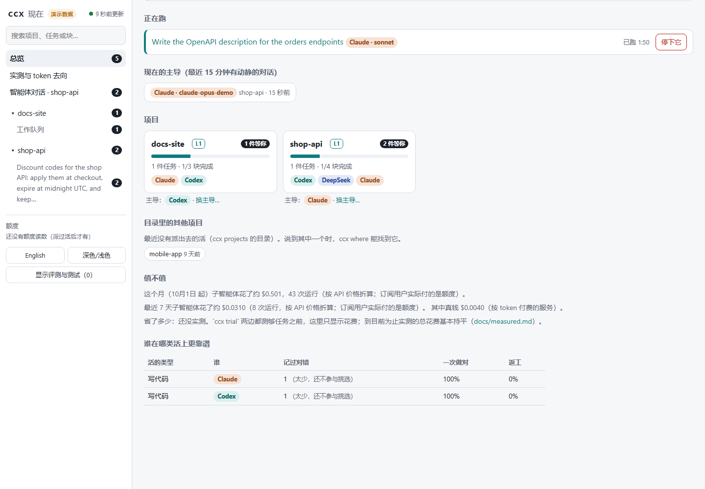
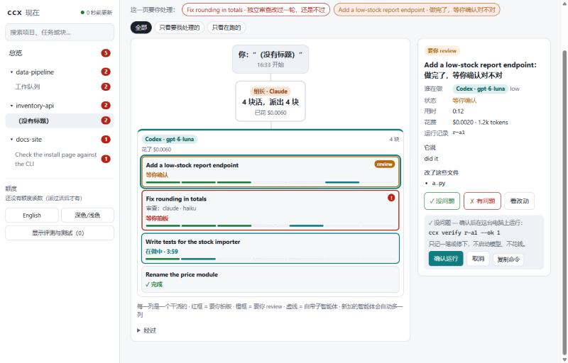

# ccx 做什么、怎么做

[English](features.md) · 中文 · 回到 [README](../README.zh.md)

## 七件事

| | 做什么 | 现在的状态 |
|---|---|---|
| **1. 互为主子** | Claude Code 当主、Codex 干活，或者反过来；DeepSeek 也能当主导（`dsh`，或跑 DeepSeek 模型的 Claude Code），也能接活（经 Claude Code、经 Codex 或 `dsh`）；Gemini CLI 可以接活（未实测）。每家一个适配器，`ccx agents` 列出每家能做什么、测过哪个版本、官方还是社区。 | 两个方向真机跑通；DeepSeek 当主导（dsh、跑 DeepSeek 的 Claude Code）和当子智能体（三条路）都真跑过；Gemini 未实测 |
| **2. 两个模型直接对话** | `ccx ask` 让另一家快速给个第二意见；`ccx resume` 在同一个子会话里追问；`ccx send` 把消息发进正在运行的 Codex 会话；`ccx say` / `ccx board` 让同一项目里开着的 Claude Code、Codex、DeepSeek 会话互相留言（每轮只看到给自己的新内容；Claude Code 桌面端只能下一轮看到，DeepSeek 会话要自己跑 `ccx board`）；`ccx discuss` 让 2–3 家不同厂商的模型把选错代价高的决定讨论清楚（出方案、挑错、裁判，最多 3 轮），在 `ccx ui` 里显示成对话。从外面派活：手机用 Remote Control，或用 `ccx intake` 把你在私人仓库开的带标签 issue 当任务取走、做完在 issue 里回报（[说明](intake.zh.md)）。 | 前三个真机可用；`ccx discuss` 真跑过两次，先两家、后三家（Codex、Claude、DeepSeek；[记录](research/2026-10-25-discuss-three-vendors.zh.md)）；`ccx intake` 只用假 `gh` 测过 |
| **3. 共享记忆** | 个人层（你的 hub：记忆、技能、MCP、账本）和项目层（`.ccx/`：背景、日志、交接、断点）。开局 hook 只推对方新写的几行；`ccx handoff` 换主导接力，`ccx fresh` 把长对话交给同一工具的新对话。**共享工作上下文**（[说明](shared-context.zh.md)）：用代码从各家会话记录摘出“最近在做什么”，派活时附上（`ccx run --context`）、按需看（`ccx peek`）、每轮推一行——各家仍各有自己的上下文。 | 真机可用；共享工作上下文：在专门需要它的任务上一次做对 36/36，不带 7/36（[A/B](research/2026-10-25-shared-context-ab.zh.md)） |
| **4. 分工合作** | 5 个问题打出难度 → 选智能体、模型、强度并给出成功率；算下来自己做更划算或该先拆，就直接说不派。`ccx batch` / `ccx q` 并行（`--lanes N`，默认关：同一家的小活续在几个热会话里，不再每块开新会话），长任务断了 `ccx task resume` 接着做。 | 选模型真机可用，但先验没校准；队列只有模拟测试 |
| **5. 省和高效** | 子智能体精简启动；`ccx lead` 看主导每轮重读多少（`--breakdown` 拆开看、`--cache` 找缓存断在哪、`--suggest` 给主导自己的档位建议）；`ccx sum` 只把大段输出里要紧的给主导。 | 工具都在；省多少取决于主导怎么用（见实测） |
| **6. 不掉质量** | ccx 自己重跑验收命令（`--check`）；另一家的模型独立审查改动（`--review`）；每次记对错（`ccx verify --ok 0 --reason wrong`），没人判的 12 小时后按证据记“大概对/错”；`ccx trial` 做一周正式对比。 | 真机可用；自动结论还没被抽查过 |
| **7. 不丢可控** | 改配置先预演、真改前备份；`ccx undo` 撤回某次运行的改动；`--mode read` / `--worktree` 不动工作区；子智能体不能再派子智能体；`ccx ui` 在本机显示谁在干什么、什么等你拍板，按钮（停下、记对错、再改一轮、改预算）先给你看要运行的 `ccx` 命令，再点一次才运行。 | 真机可用；`ccx ui` 在 Edge 和桌面端内置浏览器里开过 |

<picture>
  <source media="(prefers-color-scheme: dark)" srcset="assets/architecture-dark.svg">
  
</picture>

## 实时看：`ccx ui`

`ccx ui` 在本机打开一个页面：有什么等你处理（红框 = 要你拍板，橙框 = 看结果对不对，青色 = 在问你）、谁在干什么（每个智能体一列，新加的自动多一列）、额度按现在的速度够不够。点任何一块，右边显示原因、依据和按钮（因本机环境停下的运行，`kind: env`，显示修复提示和 `ccx doctor`，不给“再试一次”；hub 还是空的时，首页说第一步该运行什么）。它也是总管看板：`ccx projects` 目录里的所有项目（项目里有工作队列，就算这里最近没派过活也会显示；没动静的项目只占一行；项目页摘出它规则文件里讲审批的原句），以及这个月子智能体花了多少、相对估算省了多少（和 `ccx report` 同一算法，标明是估算）。会改东西的按钮——停下运行、记对错、再改一轮、续跑、允许它改、改队列预算——先显示要运行的完整 `ccx` 命令，再点一次才运行；会启动子智能体的按钮会写明要花钱，并在后台跑。页面只告诉服务端“按了哪个按钮”，从不发命令；服务端只运行固定几条 ccx 命令，按参数列表运行（不经过 shell），只接受这个页面自己的请求（同源、口令、一次性确认）。“建议记下的事”每条有同意/拒绝按钮。显示页面只读 ccx 和各工具本来就写下的文件，不调用任何模型；只监听 127.0.0.1，页面关掉约一分钟后自己退出（若当时在后台标签页，最多 5 分钟）。要你 review 的卡片并排显示“它说”（它的总结、它说自己怎么验证的）和“ccx 实际跑了”（验收命令、退出码、最后约 800 字的输出），下面是实际改动的文件和 diff：用 ccx 自己给这次运行记的快照算（运行前的树 `undo.json` 到运行结束时的树 `end.json` 或 `undo.json` 里的 `after`），从不对着现在的目录算；它报的文件和实际改动对不上时，用红框列出差别。diff 太长会截断并写明“已截断”；没有这些快照的旧运行照旧只显示它自己报的文件，并加一句说明。首页列出所有正在跑的运行（谁在跑、跑了多久、知道的话还有 token 数），每条带“停下它”按钮，同样要再点一次确认。页面在后台标签页时，“还开着”的信号会说明这一点，服务端这时等 5 分钟而不是 1 分钟才退出。待办小标签改成按钮（键盘可达），新待办会通过读屏播报。首页每条待办先说你要做什么（带颜色的小标签：要你拍板、看结果对不对、在问你），再是智能体自己的原话，最后是位置。做完的写运行卡片在 diff 旁边有**撤销这次运行**（`ccx undo <id> --apply`：按 ccx 的快照还原文件，新建的文件挪到一边，不启动任何东西，本身也不算结论；确认框列出要还原的文件，`ccx undo` 的 dry run 还会还原这次运行没改过的文件时，比如之后的提交或你自己的改动，页面不做，请你在终端用 `ccx undo <id>` 先看清单）；独立审查改过一轮还不过的运行有**审查说错了：接受**（`ccx verify <id> --ok 1`，并附说明）。worktree 里的队列块在页面和 `ccx q ls` 里是同一个顺序：先给结论（`ccx q done`），再**合并进项目**（`ccx q accept`，先跑它的 `--dry-run`，确认会合并才在后台运行；项目在受保护分支上之类的拒绝原因当场显示）。给完结论，右边面板自动换到下一件等你的（也可以按 j / k）。每张项目卡片写着现在谁主导，并链接到它的换主导面板；发给主导的话（不是命令）标成“发给主导的话”。“智能体对话”页面显示各智能体在对话板上互相写的话（`ccx say`），最新的话题在前；被机器连续条数上限停下的话题、在问你的消息（`@person`）会出现在待办里，你可以直接在页面上回复：先给你看，再点一次才以你的身份写入（via ui），最多 4000 字，永远不会运行（[对话板](board.zh.md#在-ccx-ui-里看和回复)）。`ccx ui --export 快照.html` 生成静态副本；`ccx config set ui.lang zh|en` 选语言。每个项目页（以及任务的“经过”下面）有**谁在主导**：现在由谁主导、每段时间由谁主导（来自 `.ccx/handoffs/` 里的交接记录），以及“交给 Codex 继续”/“交给 Claude 继续”（装了 `dsh` 的机器上还有 DeepSeek）。按钮同样要再点一次才运行 `ccx handoff --to <另一个> --by <当前> --cwd <项目>`；当前主导在这个目录的对话文件存在时加上 `--from-transcript <当前> --no-model`（只用代码整理，不调模型）。结果是交接文件和一行话：在那个工具里打开这个项目时贴给它（Claude Code 和 Codex 启动时也会自动显示一次这份交接；DeepSeek 不会，这一行让它去读那份文件）。找不到那个对话文件时，交接是空白模板，页面在确认前和完成后都会说明：先自己填好。任务时间线标出任务开始时由谁主导、之后每次换主导。页面上没有别的新写入。**`ccx demo`**（或 `ccx ui --demo`）不用账号就能看到这些：它在系统临时目录新建一个文件夹，写入编好的数据（两个项目、各种状态的运行且带真实快照 diff、一个工作队列、一个被停下的对话话题和一个 `@person` 提问、一个月的花费），只让它自己的进程指向那里，用同一个页面显示并标明“演示数据”。离线可用，不启动任何智能体：会启动智能体的按钮只显示命令；记对错或交接只写进演示文件夹，页面关掉后文件夹会删掉（`--keep` 或 `--dir` 保留；`--export 文件` 生成静态副本，之后同样删掉文件夹）。`--dir` 只接受新的或空的文件夹，或以前的演示文件夹。评测和测试（eval-* 标签、`--no-ab`、ccx 自己的探针、在临时目录或项目 `.ccx` 目录里跑的）默认不显示，点“显示评测与测试”才出来；`ccx verify RUN --dismiss --note 原因` 把测试残留从“等你处理”里清掉，不算对也不算错，路由也不从它学习。

英文界面、深色

截图是用 `python scripts/ui_demo.py --plain` 生成的：临时 hub、模拟命令行跑出的真实 ccx 运行，不含任何人的真实工作。

## 它怎么工作（一个例子）

你在 Claude Code 里说："把 `loader.py` 支持自定义分隔符，并补测试。"

1. Claude（主）按 5 项给任务打分（改 2 个文件、单模块、目标清楚、风险低、有现成写法），写一段不到 200 字的简报，只写目标、要看的文件、怎样算完成。
2. 执行 `ccx run --from claude --files 2 --coupling one --clarity goal "…"`。ccx 调用 task-routing 技能，算出每个“智能体:模型:强度”的成功率和每次成功的花费，挑出 `codex:gpt-6.1-sol:medium`。如果算下来自己做更划算、或者应该先拆开，就直接告诉主导，不派。
3. ccx 在后台调用 `codex exec -m gpt-6.1-sol -c model_reasoning_effort="medium" …`。会话 ID 一出现就存盘。Codex 自己读文件、改代码、跑测试，这部分 token 花的是 Codex 账号的额度。
4. Codex 必须按 JSON schema 回报：`status / summary / files_changed / verification / …`。Claude 只读这一小段，再自己看一眼 `git diff`，确认测试真的跑过，然后 `ccx verify <run_id> --ok 1`。
5. 如果 Codex 回报 `blocked`，ccx 会在**同一个 Codex 会话**里升一档（high）继续，不用重新喂背景。Codex 说做完了、但 ccx 自己重跑的 `--check` 没过，也会升一档（同一家时在同一会话里）；`ccx config set defaults.focused_retry true` 之后，这一次会拿到失败的命令和输出的最后约 2000 字，只修失败处（默认关，等实测确认再开）。如果 Codex 额度用完，自动换 Claude 做；超时或崩溃，`ccx resume <run_id>` 接着做（有检查点的长任务用 `ccx task resume`），沿用原来的标签、验收命令和 review 设置（`ccx resume` 可以用 `--check` / `--review` 改；`ccx task resume` 总是沿用）。想让它停：`ccx stop <run_id>` 结束子智能体和它开的所有进程，之后 `ccx resume` 能接上。
6. 每次运行都写进账本，结果自动记回 task-routing / task-split，下次选得更准。`ccx report` 生成看板网页：谁花了多少 token、什么类型的 token、额度用了多少、估计省了多少。

反过来，在 Codex 里用同样的命令加 `--to claude`，就是 Codex 当主、Claude Code 当子。
能不能用要看 Codex 的沙箱：ccx 要把运行记录写进 hub，子智能体要联网。`ccx doctor --codex-lead` 会检查这一点（“Codex as lead (sandbox)”那一行；普通 `ccx doctor` 里只占一行提示）。在 Windows 上真跑只有 `danger-full-access` 能用（codex-cli 0.164）：`workspace-write` 下命令用一个单独的沙箱账号运行，在里面启动的 Claude 子智能体每次改文件都被拒，把 hub 和 `~/.claude` 加进可写目录、打开网络也一样。**安全提醒：**完全访问意味着 Codex 主导跑的每条命令都带着你的全部权限、没有沙箱（你的文件、网络、凭据）；只在你愿意让它像你本人一样操作电脑时用。更窄的做法（按 Codex 官方文档可行，**还没真跑验证**）：保持 `workspace-write`，用一条 Codex 规则只让 ccx 派活的命令（`run`、`ask`、`resume`、`discuss`）在沙箱外运行：`ccx doctor --codex-rule >> ~/.codex/rules/ccx.rules`（Codex 的 rules 还是实验功能；装上后 `ccx doctor` 显示 Unknown 而不是 ok）。

**子智能体知道你和主导聊过什么吗？** 不直接知道：把一长段对话塞给每个子智能体太贵，而且 Claude 和 Codex 本来就不能共享上下文。子智能体拿到的是简报（主导浓缩的结论）、项目背景、共享记忆和原文件。连续性靠**子会话**：同一个对话、同一个目录、同一个智能体，1 小时内的下一个任务会自动接回上一个子会话，它记得已经读过、做过什么（`--new` 强制新开）。从 Claude Code 派给 Claude 子智能体时，还可以用 `--fork` 让它从你整段对话的副本开始。

## 共享的东西放在哪

全部放在你自己的 hub 文件夹里（第一次运行 `ccx init --hub <路径>` 指定，记在本机 `~/.ccx/config.toml`；不指定就用 `~/.ccx-hub`；也可以用环境变量 `CCX_HUB` 临时改）。仓库里不放任何个人内容：

| 内容 | 位置 | 两边怎么读到 |
|---|---|---|
| 记忆快照"1" | `memory/MEMORY.md` | Claude：`~/.claude/CLAUDE.md` 里 `@导入`；Codex：`AGENTS.md` 里的托管块 |
| 记忆增量"+2" | `memory/journal.jsonl` + `ccx/cursors.json` | 两边的 SessionStart hook 运行 `ccx mem delta --as <自己>`，只推送对方新增、自己没见过的条目 |
| skill | 一个 skill 只放一份（Codex 的 `skills/`、Claude 的 `skills/` 或 `hub/skills/`） | 另一边用目录链接（junction）指向它 |
| MCP | `mcp/servers.json` | `ccx sync` 用 `claude mcp add-json` / `codex mcp add` 分别注册 |
| 项目背景 | `<项目>/.ccx/context.md` | 每个子任务的简报都会指向它，子智能体开局自己读 |
| 运行记录/账本 | `ccx/runs/`、`ccx/ledger.jsonl` | `ccx show` / `ccx stats` / `ccx report` |
| 学到的参数 | `ccx/routing-state.json`、`ccx/split-state.json` | 两边共用，每次验收后自动更新 |
| 设置 | `ccx/settings.toml` | `ccx config set ...` |
| 待办队列 | `<项目>/.ccx/queue/` | `ccx q tree`；开局会提示还没做完的活 |

**什么记忆放哪里。** 用户提出的长期要求（比如“每次修改都提交”）写进用户自己的共用规则文件，要等用户同意才写。项目里的事实用 `ccx mem add --project` 记下（用 `--source` 写明从哪来的）。不再成立的记忆要替换（`--supersedes N`），不要和新的并排留着；30 天没人核对的会标成“待核对”（`ccx mem stale`、`ccx mem verify N`）；更早的记忆用 `ccx mem search` 找；开局时新增的记忆最多带约 600 token。两个工具各自的自动记忆归各自所有，ccx 不会把一边的复制到另一边。

**找记忆和分类。** `ccx mem search` 按 BM25 排序：少见的词比常见的词分量重，也不要求每个词都出现（`--all-words` 保留旧的“每个词都要有”，`--limit N` 限条数）。每条记忆属于五类之一——偏好、约束、事实、坑、事件（preference / constraint / fact / pitfall / event），都不是就算“其他”：`ccx mem add --kind` 指定；旧记录读取时按 topic 或关键词自动归类（`ccx mem kinds --list` 查看；不改写日志）。打开 `[memory] by_kind = true` 后：开局只推新的偏好和约束，子智能体简报按 BM25 挑相关的坑、事实和其他，事件只能搜到。默认关闭，开局和简报的内容不变；开不开由实测（确认实验）决定，一周的 H11 试用已于 2026-10-26 作废。`ccx mem compact --by project` 给每个项目写一小段场景块到 `memory/scenes.md`；`[memory] start_scene = true` 让开局再带当前项目那一块（默认关：开局的记忆本来就封顶约 600 token）。

**hook 不拖住每一轮。** 开局 hook（`ccx mem delta`）和每轮 hook（`ccx turn`）最多跑 `[hooks] timeout_s` 秒（默认 2 秒；
`ccx config set hooks.timeout_s N`，0 = 不限）：超时就什么都不输出、退出码 0，在 `ccx/hook-timeouts.jsonl` 记一行（命令、用时、
卡在哪一步）。`ccx doctor` 显示最近 7 天的次数。

**共享技能用了没有。** `ccx skills stats [--days N] [--json]` 从 Claude Code 和 Codex 的会话文件里数每个共享技能（hub 的
`skills/` 加本仓库的）在两边各被加载几次、最近一次是什么时候，并列出从没加载过的技能、它们的描述每轮大约占多少 token
（按字符数估算，不是分词器计数）。只读：只给建议，不删任何东西。第一次 `ccx setup` 还会问一次（只在终端里）：要不要用
`ccx mem suggest` 的规则（不调模型）扫最近 7 天的会话，把找到的偏好和坑逐条问你，你说要的才写进记忆（走 `ccx mem accept` 的流程）。

## 分级（`config/tiers.toml`，可在 `hub/ccx/tiers.toml` 覆盖）

固定分级是后备方案；带打分参数时由 task-routing 按成功率和每次成功的花费来选，并且会根据实际结果自动校准。

| 级 | 任务 | Codex | Claude Code | Gemini CLI |
|---|---|---|---|---|
| T0 | 两三步就做完 | 不派 | 不派 | 不派 |
| T1 | 机械活 | gpt-6-luna · low | haiku · low（不加载 MCP） | flash-lite |
| T2 | 常规开发 | gpt-6.1-sol · medium | sonnet · medium | flash |
| T3 | 困难 | gpt-6.1-sol · high | opus · high | pro |
| T4 | 关键/研究级 | gpt-6-astra · xhigh | opus · max | pro |

Gemini 用的是 CLI 的别名，新型号出来不用改配置；Gemini CLI 没有推理强度参数。
DeepSeek Harness（`--to dsh`）：T1–T3 用 deepseek-flash 的 low / high / max，T4 用 deepseek-v4-pro · max。

**按 token 付费的智能体**（`[providers.*]` 里的各家和 `dsh`）花的是真钱，所以每家都有 `daily_usd` 上限（默认 $1）；环境变量里没有密钥的 provider 不参与任何选择（`ccx agents` 里看 `ready`）。没有价格的模型会被拒绝运行，因为它花了多少算不出来，上限就守不住。它们不会被自动拿来在额度用完时接班，也不会自己被选为审查者；自动选模型只考虑经 Claude Code 的 DeepSeek（有标定和价格），其余几家标定之前要用 `--provider` / `--to` 指定。

## 安全边界

- 子智能体默认**可以改文件**（Codex `workspace-write` 沙箱；Claude `acceptEdits` 加工具白名单，只放行 git/python/pytest/npm/node 命令）。只想让它分析时加 `--mode read`。多个并行写任务自动放进不同 git worktree。
- 子智能体不能再派子智能体（`CCX_DEPTH`）。
- `ccx sync` 默认只预演。真改时每个被改的文件当天先备份一次。Codex 的 `config.toml` 只追加一个带标记的 hook 块，写入前先用 TOML 解析器检查。MCP 一律通过两边官方 CLI 添加。
- 不读取、不复制任何账号凭据。
